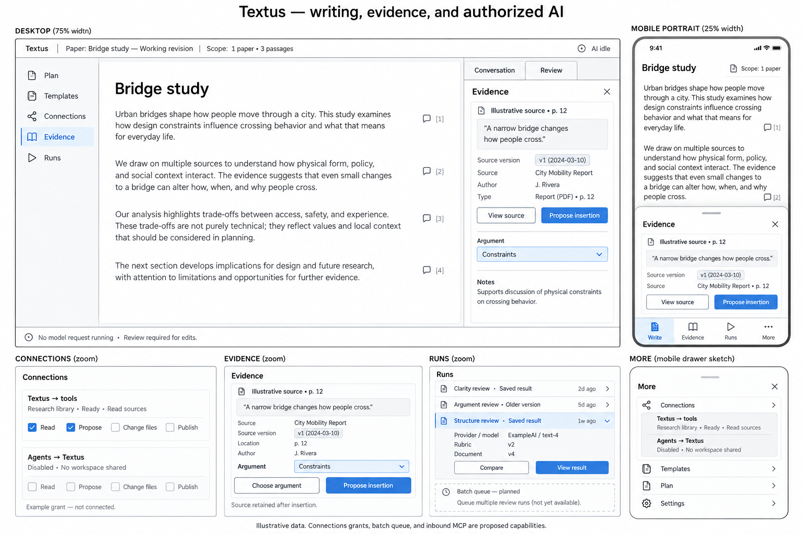

# Workbench connections, evidence and runs

Status: proposed product design, following the working writing-workbench
increment. The wireframe and contracts here do not enable an MCP server,
change existing MCP permissions, or implement the planned panels. Existing
code and gaps are recorded in the [MCP investigation](../dev/workbench/mcp-investigation.md).

## The writing surface stays central

Add **Connections**, **Evidence** and **Runs** alongside Plan and Templates.
Keep Textus's native editor, the existing Conversation/Review dock, native
split panes, and native proposal review. The author should be able to see
what an AI can access, what supports a paragraph, and which analysis actually
ran without leaving the writing workspace.

The image is an illustrative wireframe, not a screenshot of implemented
features. Its source names, dates, model labels, status and grants are sample
data. Even a server that displays **Ready** is not automatically authorized
for the current request. The checked permission boxes illustrate a future
grant; existing Textus does not enforce that permission model yet.

| Surface     | Question answered                                        | Visible by default                                                                | Detail on selection                                                                          |
| ----------- | -------------------------------------------------------- | --------------------------------------------------------------------------------- | -------------------------------------------------------------------------------------------- |
| Connections | What can each participant access and do?                 | Direction, connection state, selected workspace, access summary                   | Allowed sources and tools, protocol version, grant expiry/revoke, redacted diagnostics       |
| Evidence    | What supports this argument, and where did it come from? | Exact quotation, source title, locator, source version, Argument Block            | Bibliographic record, captured source context, verification/mapping state, uses in drafts    |
| Runs        | What happened, on which version, with which rules?       | State, document version, rubric revision, provider/model, time and billing status | Input manifest, findings, author decisions, proposal receipts, comparison and retry controls |

A single selected item drives the inspector. Avoid showing three new
full-height panels at once. Desktop keeps a compact left navigation rail,
the main document, and a context inspector in the existing right dock;
Conversation and Review remain available there. A scope summary sits next
to Run: **1 paper · 3 passages · project instructions included**, for example.
It expands into the exact manifest, including exclusions.

On mobile portrait, Write remains the default. Evidence and Runs open
focused drawers, and Connections is under More. Close returns focus and
scroll position to the selected native paragraph. A source quote, its
locator, version and **Propose insertion** remain visible together. Use
buttons as alternatives to drag gestures; do not shrink a desktop rail into
a row of unexplained icons. Mobile wireframes cover the information design,
not a promise that native MCP transports run on iOS.

## Connections has two directions

**Textus → tools** reuses the current outbound MCP client. Each connection
shows Off, Starting, Ready, Failed or Disconnected; discovery status is
separate from permission. Tools are visible by name and description, with
author-approved access and per-request inclusion. Adding or enabling a
stdio connection can start a process; show that explicitly. Refreshing
status can also start enabled connections in the current implementation.

**Agents → Textus** is a new inbound server capability. Its default is
**Disabled · No workspace shared**. The author chooses a client, workspace,
exact resources, permitted operations and expiry before a grant exists.
Do not present an installed external agent, a familiar server name or an
MCP tool annotation as proof of authority.

| Permission          | Meaning                                                                  | Initial inbound scope                                                  |
| ------------------- | ------------------------------------------------------------------------ | ---------------------------------------------------------------------- |
| Read sources        | Read only explicitly selected, versioned resources                       | Supported in the first server increment                                |
| Propose edits       | Submit a proposal to an open working revision                            | Supported after native review integration passes                       |
| Change files        | Create, replace, rename or delete files                                  | Not offered by the first server increment                              |
| Publish             | Send or publish content outside the workspace                            | Not offered by the first server increment                              |
| Run paid assessment | Charge Textus's configured provider within an approved request or budget | Separate from Read and Propose; initially requires explicit author Run |

Grant Read and Propose independently. Propose does not authorize accepting a
proposal, changing source files, exporting a workspace or publishing it.
Read does not authorize a paid rubric run. Revocation stops new requests,
cancels work where possible, and invalidates unaccepted client proposals
until the author explicitly revalidates them. Already delivered text cannot
be recalled from an external client.

Use host-owned permission checks on every operation, not disabled buttons
or model instructions. Do not expose credentials, environment variables,
HTTP headers, raw command arguments, full local paths or unredacted server
errors to a plugin view or portable package. Credential configuration stays
in native Settings. A Textus grant controls Textus's disclosures; it does
not sandbox a third-party stdio executable with the user's OS permissions.

## Workspace context is a request manifest

The author selects papers, draft versions, collected passages, optional
original snapshots, rubrics and instruction sources. Include project
instructions, style, library and memory only as listed. Keep necessary app
behavior rules separate from optional personal writing context.

Freeze that selection before cost preview. The manifest records stable
resource IDs, immutable versions/content digests, selected ranges, source
roles and exclusions. The backend must use it for context assembly and for
every tool read. Changing selection, rubric, provider/model or a selected
resource version invalidates the preview. Opening another pane or clicking
the original does not enlarge the scope or redirect the working target.

The present plugin's `textOnly` requests disable tools, but the backend still
loads normal workspace context. They must not be described as strict,
manifest-scoped requests until the backend context path is extended.

Do not turn MCP on for a rubric request by removing `textOnly`. A later
research-assisted review gets its own explicit mode, tool allowlist,
context manifest and cost policy. Standard assessment stays tool-free.

## Evidence and citation records

A collected passage is a durable record, not a floating editor block ID.
Keep its own UUID, source UUID and captured version, exact quotation,
locator (page/section/range), surrounding context where permitted, capture
method/time, bibliographic reference, and intended Argument Block IDs.
Separately record whether a quotation was verified against accessible
source text. A manually pasted or model-suggested quotation starts
unverified; a URL, DOI or citation marker alone does not verify it.

The tray can collect a native selection or an explicitly fetched research
passage. Retrieval and capture are separate from assessment. Source changes
never silently update the captured quotation. Repeated, missing, split or
ambiguous passages become unresolved rather than moving a reference to a
similar paragraph.

Selecting a passage reveals its source/version and current uses. Dragging
to an Argument Block or choosing **Propose insertion** submits the quote and
citation through native proposal review. Until acceptance, neither the
paper nor its citation references change. On acceptance, store a citation
occurrence linked to the source, captured passage, working revision and
persistent Argument Block. Reject and undo preserve the source record and
update occurrence state without inventing acceptance statistics.

Bibliographic records have author, title, year, edition, DOI/URL and other
available fields; missing metadata stays missing. A citation occurrence
also carries its own locator and style. Reuse native footnote/link rendering
where it fits. Current web-source citation helpers are not a complete
citation manager: a stable record/occurrence model and bibliography style
support still need implementation. Do not create a second editor or a
parallel rewrite-review system to add them.

## Runs and comparisons

Bring existing block analyses, paragraph notes, rubric assessments and
proposal handoffs into one browsable index. Keep their existing records as
the authority; an index does not rewrite source histories. Add versioned run
receipts for queued, running, succeeded, failed, cancelled, approval-needed
and outcome-unknown states. A local checklist is a local activity, not a
paid run or a truth grade.

A receipt pins the paper/working revision, input manifest, document version,
plan version, rubric and prompt versions, provider/model, settings relevant
to inference, tool invocations, start/end times, usage, estimate vs. actual
cost where available, findings, author decisions and native proposal IDs.
Do not store keys or hidden provider reasoning. Distinguish an external
agent's own model/bill from a Textus-provider run.

Reopening a result makes no model call. Comparing two saved runs also makes
no model call. Compare changed inputs, findings and decisions side by side;
compare scores only when criteria/scales and examined scope are compatible.
A changed model/rubric is visible, not silently normalized. **Run again**
requires a fresh preview; an identical completed assessment reuses its
saved result unless the author explicitly requests a new paid run.

## Recipes, queues, packages and dictation

| Addition                    | First useful scope                                                                                     | Required boundary                                                                                                                                           |
| --------------------------- | ------------------------------------------------------------------------------------------------------ | ----------------------------------------------------------------------------------------------------------------------------------------------------------- |
| Workflow recipes            | A saved, versioned sequence such as extract claims → assess evidence → grade → propose revisions       | Declarative known steps and typed intermediate artifacts; no executable JSON, scripts, arbitrary tool names or automatic acceptance                         |
| Batch review queue          | Twenty explicitly selected paper snapshots, bounded concurrency, progress, cancel and per-item retry   | Atomic budget reservation before dispatch, enforceable provider limits, durable receipts and no automatic rebilling after an unknown outcome                |
| Portable workspace packages | An explicitly chosen set of drafts, templates, rubrics, passages, bibliography, runs and relationships | Separate opt-in private package format; checksummed manifest, remapped IDs, collision preview, atomic staging, no credentials or transferable access grants |
| Dictation inbox             | Explicit Start/Stop capturing a thought outside the current paper, followed by author placement        | Local transcript by default; microphone indicator, interruption recovery, and separate consent/cost for cloud transcription or assessment                   |

Recipes can use existing skills and project instructions when those are
selected in the manifest; they do not duplicate provider configuration or
native review. Each paid stage needs an explicit Run or a previously
approved, bounded run grant. A wider context or a newly requested tool
requires a new grant, even inside a recipe.

A cost estimate is not a spending limit. Before shipping batch review,
reserve estimated maximum cost atomically and enforce hard input/output
limits with known pricing; record actual usage when available. Unknown
prices or unsupported output limits block a budgeted batch. Cancellation
can still incur provider charges. An interrupted request with unknown
billing remains outcome-unknown and holds its reservation until settled;
Retry must not silently issue it again. External MCP services can have
separate charges; unbounded/unknown tool charges are excluded from a
claimed all-in spending cap.

Normal template/rubric exports stay small and omit private papers, research,
preference history, grants and credentials. A private workspace package is
a separate, explicit export choice. Its importer rejects path traversal,
symlinks and executable payloads, verifies sizes/digests, keeps conflicting
IDs separate, and never auto-enables a connection or treats an imported
instruction as active configuration. A source URI may remain as a locator
without exporting source text; inaccessible references remain unresolved.

Dictation clips retain their own IDs and original transcripts. Optional
audio is private and excluded from routine exports. Choosing a target block
previews placement through native review. Stopping dictation does not start
a model request or modify the open paragraph.

## Implementation order and acceptance

1. Add host-enforced context manifests and independent access grants; specify
   protocol compatibility before exposing any inbound transport.
2. Add the local Evidence tray, citation identities and a Runs index over
   current saved records. Expose Connections with honest states and redacted
   metadata; do not label planned permissions as enforced.
3. Add an opt-in local inbound MCP adapter for authorized reads, then
   proposals through the native editor gateway. Keep file changes and
   publishing unavailable. Validate the existing outbound client separately.
4. Add declarative recipes and a bounded queue only after native usage and
   limit enforcement can support the spending contract.
5. Add explicit private workspace packages and the local dictation inbox;
   cloud dictation remains a separately enabled integration.

A first end-to-end demonstration selects one throwaway paper and source,
grants an external client Read and Propose, retrieves a captured passage,
reads coverage, submits a rewrite against a pinned working revision, and
accepts/rejects it in Textus. It must show that the source/original is
unchanged, an unselected paper cannot be listed or read, a stale proposal
is refused, revocation takes effect, and reopening a saved run costs
nothing. A rubric request from the external client must stop at author
approval unless a specific paid-run grant already covers it.

Use native Windows Tauri for named-pipe/transport startup, process shutdown,
file drag/drop, microphone, split-pane, save/undo/reopen and review behavior.
Use throwaway data; browser mocks do not establish these native guarantees.
Mobile testing needs a real supported native transport or an honest
unsupported state. Accessibility checks cover keyboard selection, focus
return, labelled status changes and a non-drag alternative for every action.

## Visual contract and review

The central native writing surface stays dominant. Scope, source locator,
version and action labels stay next to their affected text. Color indicates
selection or status with a text equivalent; hover never carries the only
source or permission detail. Open an inspector rather than nesting more
cards inside the document. Remember rail/dock widths and selected record
within the existing UI state system; a deep link may identify a view and
record, never grant access or carry a bearer credential.

The concept locks navigation, desktop/mobile reading order and the
Read/Propose/Change files/Publish distinction. It does not lock illustrative
wording, sample bibliography, icon shapes or simulated status. Product
implementation must use Textus design tokens and all ten locale entries.
The wireframe is a static PNG with this table/prose as its text alternative;
the architecture companion uses an editable Mermaid component map with a
table fallback. No runtime feature was validated by rendering the image.
