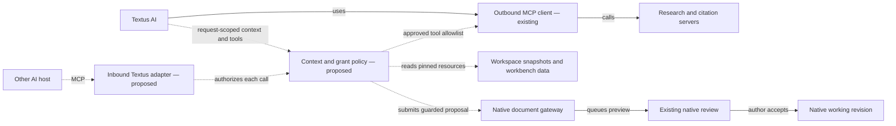

# Bidirectional MCP investigation

Status: source investigation and proposed implementation contract. This
change adds documentation and a wireframe, not an inbound server, listener,
permission enforcement or new provider requests. See the [product design
and wireframe](../../design/workbench-connections.md).

## Evidence and protocol baseline

Checked the current Textus code with the workbench changes still present,
after reading `AGENTS.md`, `CONTRIBUTING.md`, architecture, plugin API,
AI concepts and native proposal lifecycle. No OpenWriter source was changed.
The main linked [MCP architecture page](https://modelcontextprotocol.io/docs/learn/architecture)
returned HTTP 403 from the managed environment. The official specification
repository was available through Git and was inspected separately at commit
`68619e4e8bb7ae11f1aa3872a27ee06f352b9d28`.

Its `docs/docs.json` labels **2026-07-28** as latest. This matters: Textus's
client currently sends **2025-06-18**. Do not infer compatibility from the
presence of JSON-RPC or change only the version constant.

| Official source at the inspected commit                                                                                                                                                          | Design consequence                                                                                                                                                                             |
| ------------------------------------------------------------------------------------------------------------------------------------------------------------------------------------------------ | ---------------------------------------------------------------------------------------------------------------------------------------------------------------------------------------------- |
| [Architecture, 2026-07-28](https://github.com/modelcontextprotocol/modelcontextprotocol/blob/68619e4e8bb7ae11f1aa3872a27ee06f352b9d28/docs/docs/2026-07-28/learn/architecture.mdx)               | Textus is an MCP host with clients when connecting outward; a different AI host is the client of a Textus server when connecting inward. Tools, resources and prompts are separate primitives. |
| [Discovery](https://github.com/modelcontextprotocol/modelcontextprotocol/blob/68619e4e8bb7ae11f1aa3872a27ee06f352b9d28/docs/specification/2026-07-28/server/discover.mdx)                        | Servers implement `server/discover`; clients may use it to learn supported versions/capabilities. Discovery is not an access grant.                                                            |
| [Protocol overview](https://github.com/modelcontextprotocol/modelcontextprotocol/blob/68619e4e8bb7ae11f1aa3872a27ee06f352b9d28/docs/specification/2026-07-28/basic/index.mdx)                    | Current requests carry protocol/capability metadata and are stateless. A client must not rely on a legacy initialization session as the authorization boundary.                                |
| [Streamable HTTP](https://github.com/modelcontextprotocol/modelcontextprotocol/blob/68619e4e8bb7ae11f1aa3872a27ee06f352b9d28/docs/specification/2026-07-28/basic/transports/streamable-http.mdx) | Handle JSON and SSE responses, current cancellation and version semantics, Origin checks and authentication. A local server binds to loopback, not every interface.                            |
| [stdio](https://github.com/modelcontextprotocol/modelcontextprotocol/blob/68619e4e8bb7ae11f1aa3872a27ee06f352b9d28/docs/specification/2026-07-28/basic/transports/stdio.mdx)                     | Keep stdout protocol-only; implement the documented modern discovery/legacy initialization fallback deliberately. A local process is not automatically scoped to Textus's approved resources.  |
| [HTTP authorization](https://github.com/modelcontextprotocol/modelcontextprotocol/blob/68619e4e8bb7ae11f1aa3872a27ee06f352b9d28/docs/specification/2026-07-28/basic/authorization/index.mdx)     | Transport authentication and author-approved document permissions are separate. Follow current resource-server/client requirements when adding authenticated HTTP.                             |

Choose and record a protocol compatibility matrix before implementation.
Support 2026-07-28 explicitly and test a legacy 2025-06-18 adapter separately
if retaining existing server compatibility. Use a maintained SDK if one
supports the chosen matrix; confirm actual SDK versions and features rather
than assuming that a package named MCP implements the new revision. Do not
announce resources, prompts, subscriptions, tasks, sampling or elicitation
unless the implementation supports them. Paid model work must not be
triggered by an unsolicited server callback.

## What Textus already implements

| Code                                                                                                                                                                                                          | Actual behavior                                                                                                                                                                           | Reuse or gap                                                                                                                                                                                                                                                                    |
| ------------------------------------------------------------------------------------------------------------------------------------------------------------------------------------------------------------- | ----------------------------------------------------------------------------------------------------------------------------------------------------------------------------------------- | ------------------------------------------------------------------------------------------------------------------------------------------------------------------------------------------------------------------------------------------------------------------------------- |
| [`src-tauri/src/mcp/client.rs`](../../../src-tauri/src/mcp/client.rs)                                                                                                                                         | Client connection over child-process stdio or HTTP; `initialize`, `notifications/initialized`, paginated `tools/list`, `tools/call`; answers ping and refuses other stdio server requests | Reuse transport/process experience and tests. It asks for 2025-06-18, reads server identity, and does not establish the new discovery/per-request metadata contract. No resource/prompt browsing API here.                                                                      |
| [`src-tauri/src/mcp/mod.rs`](../../../src-tauri/src/mcp/mod.rs)                                                                                                                                               | Enabled server configs are started/synchronized; status, restart and try commands; every ready server's tools are assembled for an ordinary agent request                                 | Reuse the hub/status entry points. `mcp_status` calls sync and can start enabled processes: status refresh is not a side-effect-free discovery action. Request-scoped tool inclusion and per-tool permission classes are new work.                                              |
| [`src/settings/sections/mcp.tsx`](../../../src/settings/sections/mcp.tsx), [`src/prefs/mcp.ts`](../../../src/prefs/mcp.ts)                                                                                    | Settings cards configure commands or URLs, args/env/headers, on/off, tool list and status                                                                                                 | Keep configuration in native Settings. A Connections view needs a redacted projection, direction, context scope, actual grants and protocol state. Never forward raw settings into a plugin webview.                                                                            |
| [`src/platform/ipc-plugins.ts`](../../../src/platform/ipc-plugins.ts), [`src-tauri/src/lib.rs`](../../../src-tauri/src/lib.rs)                                                                                | Tauri commands expose MCP status/restart/try                                                                                                                                              | These are internal desktop IPC, not an inbound MCP endpoint or public plugin MCP API.                                                                                                                                                                                           |
| [`src-tauri/src/ai/agent/mod.rs`](../../../src-tauri/src/ai/agent/mod.rs), [`src-tauri/src/ai/tools/mod.rs`](../../../src-tauri/src/ai/tools/mod.rs)                                                          | Ordinary agent requests add MCP tools in every existing mode. MCP tools use `Access::Proposes`                                                                                            | This access value controls scheduling; it does not classify external side effects, require author confirmation for each remote call, or turn remote writes into native proposals. Do not label current Review mode as a general read-only guarantee for arbitrary MCP services. |
| [`src/plugins/host/broker-ai.ts`](../../../src/plugins/host/broker-ai.ts)                                                                                                                                     | Workbench model calls reuse configured provider, carry version/path, cancellation, size/rate/timeout limits, and set `textOnly: true`                                                     | The native branch creates an empty tool registry, so no MCP calls are offered. Preserve this default for paid rubric review.                                                                                                                                                    |
| [`src-tauri/src/ai/workspace.rs`](../../../src-tauri/src/ai/workspace.rs), [`src-tauri/src/ai/agent/context.rs`](../../../src-tauri/src/ai/agent/context.rs)                                                  | Native workspace/context assembly loads project/global instructions, skills, style, library and ordinary agent context                                                                    | Existing folder scoping is not a per-request list of approved papers/passages/instructions. Filtering the webview alone cannot implement exact context controls.                                                                                                                |
| [`src/plugins/app-bridge.ts`](../../../src/plugins/app-bridge.ts), [`src/plugins/host/broker-editor.ts`](../../../src/plugins/host/broker-editor.ts)                                                          | Open document access, explicit targets and atomic expected-text/path guards when placing a native proposal                                                                                | Reuse the native gateway mechanism; add an authenticated core caller and durable receipt/acceptance events rather than impersonating an installed plugin.                                                                                                                       |
| [`src/document-view/useEditorProposals.ts`](../../../src/document-view/useEditorProposals.ts), [proposal lifecycle](../../design/ai-proposals.md)                                                             | Proposals use native pending edits, review controls and native accept/undo                                                                                                                | External proposals must converge here. No direct editor write or file replacement fallback when review cannot be reached.                                                                                                                                                       |
| [`src/plugins/workbench/model.ts`](../../../src/plugins/workbench/model.ts), [`rubrics.ts`](../../../src/plugins/workbench/rubrics.ts), [`passage-notes.ts`](../../../src/plugins/workbench/passage-notes.ts) | Saved versioned analyses, assessments, paragraph notes, decisions and proposal handoffs                                                                                                   | Reuse records for Runs. They are not yet a persistent batch job scheduler, a bibliography, or an external-agent authorization store.                                                                                                                                            |
| [`src/ai/citations.ts`](../../../src/ai/citations.ts), [`src/ai/chat/chat-history.ts`](../../../src/ai/chat/chat-history.ts)                                                                                  | Web-source footnote conversion and native conversation persistence                                                                                                                        | Reuse formatting/history concepts; neither is a complete evidence/citation occurrence model or run ledger.                                                                                                                                                                      |

Searches of MCP references, Tauri registrations and protocol handlers found
an outbound client and test fixtures, not a service offering Textus papers,
coverage or edit proposals to external MCP clients. Do not equate plugin
`ai.tools` registration, which supplies tools to built-in Textus AI, with
serving external AI hosts.

## One policy service, two adapters

The following is a UML-like component map in Mermaid, not a formal UML
model. Solid arrows describe existing mechanisms; dashed arrows describe
proposed integration. The tables above and below are the text fallback.



Keep ownership aligned with the existing layers:

- **Core Rust:** canonical workspace/resource identity, grant enforcement,
  immutable snapshot access, request audit, provider budget reservations,
  transport authentication and MCP lifecycle. Apply policy to built-in
  requests and inbound calls, including every subsequent tool read.
- **Native document gateway:** route by workspace, document, version and
  window identity; read the current unsaved buffer only when authorized,
  queue proposals, and correlate native acceptance/rejection/undo events.
  A closed or unavailable target returns an explicit error. Never route by
  whichever tab happens to be active.
- **Workbench plugin:** plans, coverage, evidence/citation records, rubric
  definitions, declarative recipes, run presentation and Connections UI via
  supported APIs. Register a narrow data provider rather than having a
  transport parse arbitrary private plugin-store JSON or run plugin code.
- **Platform bridge:** typed IPC for the gateway and read-only redacted
  connection projections. Follow Rust/TypeScript cross-contract comments.
  Add public plugin API/version/permission documentation only for the new
  capabilities actually implemented.

The existing window-directed `plugin-ai-tool-call` request/reply mechanism
in [`src-tauri/src/plugins/ai_tools.rs`](../../../src-tauri/src/plugins/ai_tools.rs)
is an architectural precedent for Rust → owning window → result, not an
inbound authorization implementation. Do not copy its broadcast tool list
as a grant list, trust client-supplied window labels, or accept an arbitrary
plugin tool result as proof that a document changed.

## Inbound transport decision

Prefer an opt-in local stdio MCP adapter backed by an authenticated desktop
broker for the first iteration. The external host starts the adapter;
the author pairs it with Textus and grants selected resources in Textus.
On Windows, investigate a current-user-only named pipe; on Unix, a
current-user-only local socket. The adapter itself must not open arbitrary
workspace files or treat a command-line folder as authorization. Binding a
grant to a client requires host-generated identity/credentials, not a name
the client chose. Keep credentials out of command lines, portable configs,
logs and webviews. Closing Textus fails calls clearly; it does not start a
second headless editor or silently apply proposals to disk.

This is a proposed choice, not a claim that Textus already has a pipe/socket
broker. Verify pairing, ACLs, lifecycle, concurrent windows and cancellation
in a real Windows build before offering it. Disabled means no listening
service and no auto-launched adapter. Pairing is not implied by installing
an MCP configuration.

Add Streamable HTTP later only if a remote client requirement justifies it.
A local HTTP variant requires loopback binding, Origin validation, proper
authentication, current protocol handling and the same grants. A network
service needs the current MCP/OAuth resource-server design and explicit
remote-sharing scope. Do not expose the Tauri IPC bridge or a public
unauthenticated listener as the MCP server.

## Proposed resource and tool contract

All names here are proposed. MCP version negotiation and Textus application
permissions are separate contracts. Workspace, document, passage, Argument
Block, rubric and run identities are persistent UUIDs, not mutable paths or
content-derived editor block IDs. A resource URI identifies a versioned
snapshot, for example `textus://workspace/<uuid>/paper/<uuid>?version=<id>`.
Only resources in the caller's current grant are discoverable or readable.
A reference URI is an identifier, not authority to fetch an arbitrary URL.

| Illustrative tool           | Required scope                                      | Result and effect                                                                                                    |
| --------------------------- | --------------------------------------------------- | -------------------------------------------------------------------------------------------------------------------- |
| `textus_read_workspace`     | Read selected workspace                             | Authorized manifest and resource summaries; no recursive directory listing or unrelated project/global context       |
| `textus_list_source_papers` | Read selected paper IDs                             | Paginated granted papers and pinned versions; no titles/counts from excluded papers                                  |
| `textus_get_passages`       | Read selected passage/source IDs                    | Exact captured quotation, source version, locator, bibliographic ID and verification state                           |
| `textus_read_coverage`      | Read selected paper/plan version                    | Unfinished intentions, provisional findings and separate author decisions; stale/unresolved mappings remain labelled |
| `textus_request_rubric_run` | Paid assessment scope in addition to selected reads | Saved matching result, or an approval-needed receipt. Does not bill merely because an external client calls it       |
| `textus_propose_edit`       | Propose to selected working revision                | Native proposal receipt, never an applied edit; guards include expected document and plan versions                   |

Resources expose stable read data; tools perform bounded queries/actions.
Optional MCP prompts may expose author-selected recipe templates later;
listing/getting a prompt never starts a model run. Do not advertise an
accept-edit, arbitrary file-write, publishing or unrestricted fetch tool
in the first server.

A conceptual operation envelope is:

```json
{
  "contract": "textus-workbench-request/1",
  "grantId": "host-issued-reference-not-a-client-created-grant",
  "requestId": "client-idempotency-key",
  "workspaceId": "workspace-uuid",
  "manifestId": "host-frozen-context-manifest-id",
  "documentId": "working-revision-uuid",
  "expectedVersion": "snapshot-id-and-content-digest",
  "expectedPlanVersion": "plan-version",
  "operation": "propose_edit",
  "arguments": {
    "argumentId": "persistent-argument-uuid",
    "target": "host-issued-current-passage-reference",
    "text": "Proposed Markdown",
    "reason": "Why this change helps"
  }
}
```

The host resolves and validates every identifier; this example is not a
live grant or executable API. Never take a role, permission, path or price
in a client payload as proof of authorization. Bound request/result sizes,
pagination, rate, time and concurrency, with cancellation tied to the
caller/request. Return explicit version-conflict, denied, unresolved,
review-unavailable, approval-needed and outcome-unknown states without
leaking excluded document names.

A manifest lists selected resource IDs, roles, immutable version/digest,
ranges with a declared coordinate system, instruction-source versions,
provider/model, rubric revision and exclusions. Build the actual provider
context from this manifest; implicit workspace/style/memory reads must not
bypass it. Validate digest/range against the same Markdown representation
on both sides of the Rust/TypeScript boundary.

For a proposal, resolve current editor blocks from the persistent Argument
Block/passage mapping, then recheck exact text/path/version atomically at
placement and native acceptance. Persist a receipt with caller, target,
expected version, native proposal ID and state. The current plugin handoff
returns a boolean and records handoff; reliable acceptance/rejection/undo
correlation is additional gateway work. Revocation invalidates outstanding
client authority. Keep frozen originals read-only even if a client asks to
change one.

## Cost and retry contract

MCP reads, resource/prompt discovery, panel switching and reopening results
never invoke Textus's model provider. `textus_request_rubric_run` first
resolves the frozen context, provider/model and rubric; an authorized saved
match is returned locally. Otherwise the native Runs UI requests author
Run, or checks a previously approved bounded run grant. Never translate a
read grant into a paid-run grant.

A run ledger owns durable idempotency, atomic cost reservation, dispatch,
provider request ID/usage, cancellation and retry outcomes. A UI estimate
and the present broker's prompt/rate/time limits do not provide a hard USD
cap or a hard output-token limit. Enforce those at the provider/native
request path before enabling budgeted batch claims. A partially billed or
unknown outcome is not an automatically retriable failure.

## Reviewable implementation slices

| Slice              | Reuse                                                                    | New work                                                                                                 | Completion evidence                                                                                                          |
| ------------------ | ------------------------------------------------------------------------ | -------------------------------------------------------------------------------------------------------- | ---------------------------------------------------------------------------------------------------------------------------- |
| Context/grants     | Existing project identity/storage and native context assembly            | Per-request frozen manifest, canonical resolution, independent permissions, revoke and tool filtering    | Unselected paper and instruction content absent from provider payload and every tool read; concurrent grant revocation tests |
| Connections        | Native Settings MCP hub/status                                           | Redacted projection and narrow plugin API, explicit direction, honest protocol/grant states              | Refresh/start side effects explained; no credentials in UI, logs or export; no model calls from navigation                   |
| Evidence/citations | Native selection, persistent argument IDs, proposal and footnote helpers | Stable source/passage/bibliography/occurrence records, capture verification, accepted-use reconciliation | Collect → propose → accept/reject/undo; original unchanged; rename/reopen/ambiguous-source cases                             |
| Runs               | Existing assessment/analysis/note records and native chat persistence    | Index and durable run receipts; comparable-version view; native proposal outcome correlation             | Reopen/compare without model calls; changed rubric/model clearly labelled; interrupted/unknown outcomes retained             |
| Inbound reads      | New adapter with scoped snapshot/data service                            | Protocol conformance, pairing/auth, per-call grant checks and bounded discovery/reads                    | Independent MCP client/Inspector, legacy/current matrix, invalid/revoked grant, excluded-name and closed-window cases        |
| Inbound proposals  | Native pending edit pipeline and atomic guards                           | Owning-window gateway, caller-scoped receipts, version and revoke revalidation                           | External rewrite → native review → accept/reject/undo; stale/refused targets never written to disk                           |
| Recipes/queue      | Skills, rubric runner and provider settings                              | Declarative step schemas, usage accounting, durable retries, hard budget enforcement                     | Twenty throwaway papers, progress, stop/restart, reservation races, no duplicate billing; provider-limit evidence            |
| Packages/dictation | Native file/import/export and editor integration                         | Separate private package manifest/remapping and local capture inbox                                      | Round trip relationships without secrets/grants; source digest checks; Windows capture/drag/drop and interruption recovery   |

Do not add an inbound listener as a shortcut to the first two slices.
Do not enable all external tools for a scoped review as a shortcut to
research integration. Split each slice by concern under the repository's
600-line/8-hook/layer rules and retain the existing provider/proposal APIs
until a required public capability cannot reasonably fit them.

## Validation limits

This investigation includes code inspection and official protocol-source
review. The wireframe uses illustrative data. No new MCP transport, live
server, external-client grant, provider request, batch budget, source
citation verification, microphone or native Windows behavior was exercised
by this documentation change. Earlier workbench tests cover earlier
features only. Runtime acceptance needs focused unit/editor tests,
independent MCP conformance tests, and real Windows Tauri checks with
throwaway workspaces and a short recording of the native workflow.
